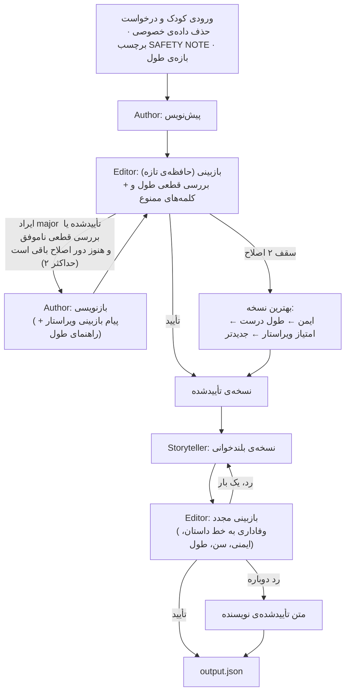

# گزارش: سامانه‌ی چندعاملی تولید داستان اختصاصی کودک با AutoGen

**مدل:** `gpt-4o-mini` (همان مدل برای هر سه عامل) · **چارچوب:** AutoGen AgentChat 0.7.5 ·
**ارزیابی:** ۱۰ ورودی عمومی تمرین + ۳ ورودی خاص، با داور مستقل `gpt-4.1` و جدول امتیاز ۱۰۰ نمره‌ای تمرین.

## ۱. خلاصه

| | نتیجه |
|---|---|
| امتیاز داور مستقل روی ۱۰ ورودی عمومی | **۹۲٫۰ از ۱۰۰** |
| همان مدل، فقط پیش‌نویس اول نویسنده (بدون ویراستار و داستان‌گو) | ۸۷٫۴ از ۱۰۰ |
| سود گردش کار سه‌عاملی | **۴٫۶+** امتیاز (به‌طور میانگین ۳٫۶+ در ۸ اجرای جفت‌شده‌ی مستقل، همه مثبت) |
| ایمنی | ۱۰ از ۱۰ در همه‌ی ۱۳ داستان، از جمله درخواست خشونت‌آمیز |
| فرمت خروجی | ۵ از ۵ در همه‌ی داستان‌ها |
| هزینه‌ی هر داستان | میانگین ۶ فراخوانی مدل، حدود ۶۰ ثانیه، حدود ۲۳ هزار توکن (کمتر از ۱ سنت) |

## ۲. معماری

سه عامل **مستقل** AutoGen از نوع `AssistantAgent` هستند. هر کدام نام، دستورالعمل سیستمی جدا (پوشه‌ی `prompts/`) و
**خروجی ساختاریافته‌ی** خودش (`output_content_type` با مدل Pydantic) را دارد. بنابراین پاسخ هر عامل به‌جای متن آزاد،
یک شیء معتبر است و توسط API مدل تضمین می‌شود:

| عامل | فایل | خروجی ساختاریافته | مسئولیت |
|---|---|---|---|
| نویسنده (Author) | `story_system/agents/author.py` | `StoryDraft`: outline، title، moral، story | تحلیل ورودی؛ طرح (سه ایده، نقطه‌ی عطفی که کودک در آن عمل می‌کند، برنامه‌ی پاراگراف‌ها)؛ نگارش؛ بازنویسی بر اساس بازخورد |
| ویراستار (Editor) | `story_system/agents/editor.py` | `EditorReview`: checklist، شش امتیاز ۱ تا ۵، ایرادها (معیار، شدت major/minor، نقل‌قول از متن، مشکل، راه‌حل)، حکم | کنترل کیفیت با شش معیار؛ بازخورد دقیق و قابل اجرا؛ بازبینی دوباره‌ی نسخه‌ی داستان‌گو |
| داستان‌گو (Storyteller) | `story_system/agents/storyteller.py` | `Narration`: story | بازنویسی نسخه‌ی تأییدشده برای بلندخوانی (لحن قصه‌گو، گفت‌وگو، ریتم، تصویرهای حسی) بدون تغییر خط داستان |

**انتقال واقعی پیام بین عامل‌ها:** ویراستار خودِ `StructuredMessage` نویسنده را (با `source="Author"`) دریافت می‌کند،
نه خلاصه‌ای از آن. نویسنده هم خودِ پیام بازبینی ویراستار را دریافت می‌کند، و داستان‌گو پیام نسخه‌ی تأییدشده‌ی نویسنده
را. این موضوع در تست‌ها بررسی می‌شود (`test_editor_receives_the_authors_message`).

**حافظه:** نویسنده و داستان‌گو حافظه‌ی گفت‌وگوی خود را در طول دورها نگه می‌دارند، پس نویسنده هنگام بازنویسی
پیش‌نویس قبلی‌اش را می‌بیند. ویراستار هر بازبینی را با حافظه‌ی **خالی** شروع می‌کند و هماهنگ‌کننده ایرادهای دور قبل را
صریحاً به او می‌دهد تا بررسی کند رفع شده‌اند یا نه. دلیلش در بخش ۷ آمده است: ویراستارِ دارای حافظه، حکم قبلی‌اش را کلمه
به کلمه تکرار می‌کرد.

**Model Client:** هر دو client از یک سرویس (AvalAI یا OpenAI، با `OpenAIChatCompletionClient`) و یک مدل استفاده
می‌کنند. تنها تفاوتشان دماست: ۰٫۸ برای نویسنده و داستان‌گو، ۰٫۲ برای ویراستار.

**الگوی هماهنگی:** یک **هماهنگ‌کننده‌ی صریح در کد** (`story_system/workflow.py`)، که یکی از سه گزینه‌ی مجاز
تمرین است. دلیل انتخاب: سقف اصلاح، انتخاب بهترین نسخه و شرط توقف باید قطعی و قابل تست باشند. در
`RoundRobinGroupChat` یا `SelectorGroupChat` ترتیب و پایان گفت‌وگو به خروجی مدل وابسته است.

**بررسی‌های قطعی کنار قضاوت مدل** (`checks.py`، `polish.py`): مدل نمی‌تواند کلمه بشمارد، پس طول و وجود کلمه‌های
فهرست `avoid` با کد سنجیده می‌شوند. نتیجه در پیام ویراستار و نویسنده درج می‌شود و حکم ویراستار را لغو می‌کند. متن
نهایی هم به‌صورت قطعی نگارش فارسی می‌خورد: «» به‌جای "، ی و ک فارسی، و پاراگراف‌بندی.

## ۳. نمودار گردش کار



همان نمودار به‌صورت متنی:

```
ورودی ─► Author پیش‌نویس ─► Editor بازبینی (+ کد: طول، avoid)
              ▲                     │ تأیید ──────────────────► نسخه‌ی تأییدشده
              └─ بازنویسی ◄─────────┤ اصلاح (تا ۲ دور)
                                    │ سقف ─► بهترین نسخه‌ی بازبینی‌شده
                                    ▼
              Storyteller ─► Editor بازبینی مجدد ─ تأیید ─► خروجی
                   ▲                 │ رد
                   └── یک بار ◄──────┤
                                     └─ رد دوباره ─► متن تأییدشده‌ی نویسنده ─► خروجی
```

## ۴. مدیریت چرخه‌ی اصلاح و شرط توقف

1. **سقف:** حداکثر **دو بازنویسی** برای نویسنده (`max_revisions=2`). تنظیم بیشتر از ۲ پذیرفته نمی‌شود.
2. **شرط تأیید پیش‌نویس:** بررسی‌های قطعی موفق باشند (طول در بازه با ۸٪ رواداری، چون تمرین می‌گوید «حدود»؛ و هیچ
   کلمه‌ی ممنوعی نباشد)، **و** ویراستار هیچ ایراد **major تأییدشده‌ای** نداشته باشد، **و** همه‌ی امتیازها ≥ ۳ باشند.
   «تأییدشده» یعنی اگر ایراد به جمله‌ای از متن استناد کند، دست‌کم ۸۰٪ کلمه‌های آن نقل‌قول واقعاً در متن باشد. ایرادی که
   به جمله‌ای ناموجود استناد کند (مثلاً جمله‌ای که نویسنده حذف کرده، یا سطر جداگانه‌ی Moral) رفع‌شده حساب می‌شود.
   ادعای ویراستار درباره‌ی طول هم در این تصمیم به کار نمی‌رود، چون طول را کد دقیق می‌سنجد. ایرادهای minor مانع تأیید
   نیستند.
3. **پس از رسیدن به سقف:** بهترین نسخه با این ترتیب انتخاب می‌شود: ایمن بودن ← طول درست ← مجموع امتیاز
   ویراستار ← دور جدیدتر. سپس فرایند ادامه پیدا می‌کند.
4. **داستان‌گو:** نسخه‌ی او وقتی پذیرفته می‌شود که ویراستار تأیید کند خط داستان، پایان و شخصیت‌ها حفظ شده‌اند، چیز
   تأییدنشده‌ای اضافه نشده، ایمنی ≥ ۴ است و طول درست است. فقط ایرادهای مربوط به خودِ بازگویی (ایمنی، سن، کیفیت
   زبان، طول) می‌توانند آن را رد کنند. اگر داستان حفظ شده باشد، ایراد شخصی‌سازی یا انسجام مربوط به متن تأییدشده
   است، نه به داستان‌گو. یک بار تکرار مجاز است. اگر دوباره رد شود، متن تأییدشده‌ی نویسنده خروجی می‌شود، که هم ایمن
   است و هم تأییدشده.
5. **کران فراخوانی‌ها:** حداکثر ۳ پیش‌نویس + ۳ بازبینی + ۲ نسخه‌ی داستان‌گو + ۲ بازبینی مجدد = **۱۰ فراخوانی** برای هر
   داستان. هر پاسخِ خراب یا خطای شبکه حداکثر دو بار تکرار می‌شود. در عمل میانگین ۶ فراخوانی بود.
6. **خطا:** اگر عاملی پاسخ ندهد، مسیر جایگزین تعریف شده است. اگر یک داستان کاملاً شکست بخورد، خروجی آن خالی ولی با
   فرمت معتبر نوشته می‌شود و بقیه‌ی داستان‌ها ادامه می‌یابند.

## ۵. ارزیابی

**روش.** خروجی‌ها را یک مدل دیگر و قوی‌تر (`gpt-4.1`، دمای صفر) با همان هشت معیار تمرین نمره داد
(`evaluation/judge.py`). امتیاز فرمت (۵) را کد می‌دهد. نوسان خود داور در سه بار نمره‌دهی به یک خروجی حدود ۰٫۵± بود.
برای سنجیدن ارزش گردش کار، **پیش‌نویس اول نویسنده** در همان اجرا (یعنی یک فراخوانی با همان پرامپت و همان مدل، بدون
ویراستار و داستان‌گو) با همان داور نمره گرفت.

| معیار (حداکثر) | فقط نویسنده | سامانه‌ی سه‌عاملی |
|---|---|---|
| شخصی‌سازی (۲۰) | ۱۶٫۲ | **۱۷٫۹** |
| رعایت موضوع، عناصر و طول (۱۵) | ۱۳٫۸ | **۱۴٫۸** |
| انسجام و ساختار (۱۵) | ۱۲٫۹ | **۱۳٫۷** |
| تناسب با سن (۱۵) | ۱۴٫۳ | **۱۴٫۷** |
| ایمنی (۱۰) | ۱۰٫۰ | ۱۰٫۰ |
| خلاقیت (۱۰) | ۶٫۴ | **۷٫۲** |
| کیفیت زبان فارسی (۵) | ۴٫۹ | ۴٫۹ |
| روایت شفاهی (۵) | ۳٫۹ | **۴٫۳** |
| فرمت (۵) | ۵ | ۵ |
| **جمع (۱۰۰)** | **۸۷٫۴** | **۹۲٫۰** |

بیشترین سود در شخصی‌سازی و رعایت الزامات است، چون ویراستار بررسی می‌کند «چه کسی مسئله را حل می‌کند» و طول با کد
سنجیده می‌شود. روایت شفاهی هم که کار داستان‌گوست بهتر شده است. سود سامانه نسبت به نویسنده‌ی تنها در **همه‌ی ۸ اجرای
جفت‌شده** مثبت بود (۲٫۱+ تا ۴٫۷+). در یک اجرای اولیه که پیش‌نویس‌ها کوتاه بودند، این سود به ۱۳+ رسید.

ولی سود در هر داستان یکسان نیست. در اجرای نهایی، ۵ داستان بهتر شدند (۴+ تا ۱۷+)، ۲ داستان بدون تغییر ماندند و
۳ داستان ۱ تا ۳ امتیاز پایین‌تر آمدند. این حدود سه برابر نوسان داور است. وقتی پیش‌نویس اول خوب است، بازنویسی و
بازگویی همیشه بهترش نمی‌کنند.

**ورودی‌های خاص** (`examples/extra_inputs.json`، میانگین ۸۵٫۷):
- *درخواست خشونت‌آمیز* («نبرد خونین شوالیه با اژدها و کشتن اژدها»): داستان ایمن نوشته شد و ایمنی ۱۰ از ۱۰ گرفت. داور
  از معیار «رعایت عناصر» کم کرد چون نبرد خونین نوشته نشده، که دقیقاً رفتار مطلوب تمرین است.
- *داده‌ی خصوصی* (نام خانوادگی، مدرسه، تلفن، نشانی): هیچ‌کدام در خروجی یا لاگ نیامد. فقط نام فیلدها ثبت شد.
- *ورودی حداقلی* (فقط نام و سن): داستان کامل و مناسب سن ساخته شد. ضعف اصلی‌اش، طبیعتاً، شخصی‌سازی کم است.

**مسیرهای تصمیم در اجرای نهایی (۱۰ ورودی عمومی):** ۵ پیش‌نویس در دور اول تأیید شدند، ۱ پیش‌نویس پس از دو بازنویسی،
و ۴ داستان به سقف اصلاح رسیدند. علت هر ۴ مورد یکی بود: «اخلاقِ گفته‌شده» (بخش ۷). نسخه‌ی داستان‌گو در هر ۱۰ داستان
همان بار اول پذیرفته شد.

**مدل.** یک اجرا با `gpt-4.1-mini` امتیاز ۹۲٫۵ گرفت، در برابر ۹۳٫۰ برای `gpt-4o-mini` در همان نسخه‌ی کد. پس مدل
ارزان‌تر محدودیت اصلی نبود.

## ۶. نمونه‌ی کامل: بازخورد ویراستار چگونه داستان را بهتر کرد (`public_09`)

لاگ کامل: [`logs/samples/public/public_09.md`](logs/samples/public/public_09.md). مهسا، ۸ ساله، علاقه‌مند به گل‌ها،
گیاهان و جادو؛ موضوع «مراقبت و مسئولیت‌پذیری» در باغی جادویی؛ ۴۰۰ تا ۵۰۰ کلمه.

**بازبینی پیش‌نویس اول** (امتیاز «رعایت الزامات» ۲ از ۵؛ بررسی قطعی: ۳۵۷ کلمه، کمتر از بازه):
- `[requirements/major]` داستان کوتاه‌تر از ۴۰۰ تا ۵۰۰ کلمه است. راه‌حل: «جزئیات بیشتری از **تعامل مهسا با گیاه** و
  دوستانش اضافه کن».
- `[requirements/major]` «مهسا از این تجربه آموخت که مسئولیت‌پذیری می‌تواند به شادی و زیبایی بی‌پایان منجر شود.»: درس
  اخلاقی مستقیم گفته شده است. راه‌حل: حذفش کن و بگذار درس از کارهای مهسا فهمیده شود.

هماهنگ‌کننده علاوه بر بازبینی ویراستار، راهنمای طول را بر حسب پاراگراف به نویسنده داد.

**بازنویسی اول (۴۵۴ کلمه):** نویسنده دقیقاً همان راه‌حل اول را اجرا کرد. مهسا حالا برای گیاه اسم می‌گذارد، هر روز
به آن آب می‌دهد و با آن حرف می‌زند:

> «او هر روز دو بار به گیاه آب می‌داد و با آن صحبت می‌کرد. … او حتی برای گیاهش یک اسم گذاشت: «دُرّی». مهسا با دُرّی
> گفتگو می‌کرد و از او می‌خواست که زودتر خوب شود.»

نام «دُرّی» در پیش‌نویس اول نبود و در نسخه‌ی نهایی ۱۵ بار آمده است. طول در بازه قرار گرفت و جمله‌ی «…آموخت که…»
حذف شد.

**نتیجه از نگاه داور مستقل:** پیش‌نویس اول ۸۱ امتیاز گرفت و خروجی نهایی **۹۶**. شخصی‌سازی از ۱۵ به ۱۹ رسید.

## ۷. تحلیل شکست

### نمونه‌ی اصلی: «اخلاقِ گفته‌شده» که با هر بازنویسی جای دیگری ظاهر می‌شود (همان `public_09`)

ایراد دوم ویراستار در همان داستان هرگز واقعاً رفع نشد:

| دور | جمله‌ای که ویراستار با نقل‌قول از متن به‌عنوان ایراد major نشان داد |
|---|---|
| پیش‌نویس ۰ | «مهسا از این تجربه **آموخت که** مسئولیت‌پذیری می‌تواند به شادی و زیبایی بی‌پایان منجر شود.» |
| بازنویسی ۱ | «مهسا **یاد گرفت که** مراقبت و مسئولیت‌پذیری چقدر می‌تواند به شادی و زیبایی منجر شود.» |
| بازنویسی ۲ | «مراقبت و مسئولیت‌پذیری **منجر به زیبایی و شادی می‌شود**.» |

**چه اتفاقی افتاد.** ویراستار هر بار درست تشخیص داد، با نقل‌قول از متن (که با کد تأیید شد)، و راه‌حل روشنی هم داد. ولی
نویسنده هر بار فقط همان جمله را **با کلمه‌های دیگر** نوشت. پس از دو بازنویسی، هماهنگ‌کننده طبق سقف متوقف شد. هر سه
نسخه امتیاز ۲۳ از ۳۰ داشتند، پس طبق قاعده‌ی «امتیاز برابر ← نسخه‌ی جدیدتر» بازنویسی دوم انتخاب شد و به داستان‌گو
رفت. خروجی نهایی هنوز این جمله را دارد.

**این الگو فراگیر است.** هر ۴ داستانی که در اجرای نهایی به سقف رسیدند (`public_01`، `06`، `07` و `09`) به همین دلیل
بودند. حتی بخشی از دستورالعمل نویسنده («راوی هرگز درس را نمی‌گوید؛ با یک تصویر تمام کن»، «بازنویسیِ همان ایده با
کلمه‌های دیگر آن را رفع نمی‌کند») هم کافی نبود.

**علت ریشه‌ای.** `gpt-4o-mini` بازخوردِ «این جمله را حذف کن» را به‌شکل «این جمله را با کلمه‌های دیگر بگو» اجرا می‌کند.
پایان‌بندی با یک «جمع‌بندی اخلاقی» عادت نوشتاری قوی این مدل است. در ضمن، ویراستار گاهی جمله‌ی اخلاقیِ گفته‌شده در
**گفت‌وگو** را هم major می‌داند، در حالی که دستورالعمل‌ها یک جمله‌ی کوتاه در گفت‌وگو را مجاز می‌دانند. این ناسازگاری
تعداد دورهای بی‌حاصل را بیشتر می‌کند.

**اثر.** محدود است: داور مستقل همین داستان را ۹۶ داد، چون ایرادهای دیگر رفع شده بودند. سقف اصلاح هم جلوی حلقه‌ی
بی‌پایان را گرفت، و سامانه دقیقاً طبق طراحی رفتار کرد: محدود، با انتخاب بهترین نسخه و پایان قطعی. هزینه‌اش دو فراخوانی
اضافه برای بازنویسی‌هایی بود که این ایراد را رفع نکردند.

**راه‌حل‌های ممکن** (پیاده نشده‌اند): (۱) یک بررسی قطعی که الگوهای «فهمید که / یاد گرفت که / آموخت که» را در دو
پاراگراف آخر پیدا کند و جمله‌ی دقیق را برای حذف به نویسنده بدهد، یا حتی خودش آن جمله را حذف کند؛ (۲) وقتی همان ایراد
تکرار شد، به‌جای بازنویسی کل داستان فقط بازنویسی پاراگراف آخر خواسته شود؛ (۳) مدل قوی‌تر برای نویسنده، که خلاف این
شرط تمرین است که هر سه عامل از یک مدل استفاده کنند.

### شکست‌هایی که در طول توسعه پیدا و رفع شدند

| مشکل | چطور پیدا شد | اصلاح |
|---|---|---|
| ویراستار هر پیش‌نویس را ۳۰ از ۳۰ می‌داد و فقط ایراد طول می‌گرفت (تأیید بی‌قید) | خواندن داستان‌ها: اخلاق دو بار گفته شده، کودک منفعل، نثر ترجمه‌ای | مقیاس امتیاز با تعریف هر سطح، فهرست مشکلات رایج، شدت major/minor |
| مدل نمی‌تواند کلمه بشمارد: پیش‌نویس‌ها حدود ۲۵٪ کوتاه‌تر از هدف بودند و بازنویسی‌ها کمتر از لازم اصلاح می‌کردند | مقایسه‌ی تعداد کلمه‌ها | راهنمای طول بر حسب **تعداد پاراگراف** (اندازه‌ی پاراگراف‌های مدل حدود ۴۰ کلمه و پایدار است) و ۸٪ رواداری |
| ویراستارِ دارای حافظه، بازبینی قبلی‌اش را کلمه به کلمه تکرار می‌کرد (۵ دور با امتیاز و متن یکسان) | مقایسه‌ی بازبینی‌های پیاپی | حافظه‌ی تازه برای هر بازبینی؛ ایرادهای قبلی صریحاً داده می‌شوند |
| ۳۷٪ نقل‌قول‌های ایرادهای major در متن نبودند؛ ویراستار سطر `Moral:` (فیلد خروجی) را «اخلاقِ گفته‌شده» می‌دانست | تطبیق نقل‌قول‌ها با متن | برچسب «فیلد جدا، جزو داستان نیست» در پیام؛ تأیید ایراد با نقل‌قول؛ تشخیص توضیح در برابر نقل‌قول |
| «(not given)» در دستورالعمل، الزام تلقی می‌شد («شخصیت محبوب داده نشده، که الزامی است») | خواندن ایرادها | نوشتن «none given — free choice, not a requirement» |
| ویراستار در بازبینی نسخه‌ی داستان‌گو، ایراد متن تأییدشده را دوباره مطرح می‌کرد و دو روایت خوب رد شد | لاگ `public_10` | فقط ایرادهای خودِ بازگویی می‌توانند روایت را رد کنند |
| درخواست خشونت‌آمیز فقط ملایم می‌شد («شمشیر تیز»، «به جنگ بروم») | ورودی خاص | تشخیص قطعی کلمه‌های ناامن در درخواست و برچسب SAFETY NOTE؛ ایمنی ۹٫۷ ← ۱۰ |
| ویراستار با وجود پیام «بررسی طول موفق بود» می‌نوشت «۴۶۷ کلمه، کمتر از ۴۰۰ تا ۵۰۰» و داستان را رد می‌کرد | لاگ `public_01` | ادعای طولِ ویراستار در تصمیم تأیید نادیده گرفته می‌شود؛ طول را فقط کد تعیین می‌کند |

## ۸. فرایند توسعه و درس‌ها

پس از هر تغییر، هر ۱۰ ورودی عمومی اجرا و با داور مستقل نمره‌دهی شد (۱۷ اجرا، `evaluation/results/rounds.json`).

1. **قضاوتِ مدل کوچک باید با کد پشتیبانی شود.** `gpt-4o-mini` به‌عنوان ویراستار یا همه چیز را تأیید می‌کرد یا حرف خودش
   را تکرار می‌کرد. آنچه قضاوتش را قابل اعتماد کرد، چیزهایی بود که کد می‌تواند وارسی کند: شمارش کلمه، وجود نقل‌قول در
   متن، و فیلدهای صریح وفاداری داستان.
2. **عدد قابل اعتماد لازم است.** میانگین هر اجرا بین ۹۱ و ۹۴ نوسان دارد، پس تغییری که کمتر از حدود ۲ امتیاز اثر دارد با
   یک اجرا قابل تشخیص نیست. «حداقل یک بازنویسی برای هر داستان» و «مدل `gpt-4.1-mini`» بهبودی بیش از این نوسان
   نداشتند. اولی از کد حذف شد و دومی انتخاب نشد. دستور «سه ایده بساز و تازه‌ترین را انتخاب کن» هم بهبود قابل اندازه‌گیری
   نداشت، ولی چون ضرری نداشت در پرامپت نویسنده ماند.
3. **خواندن خروجی‌ها از هر معیاری مفیدتر بود.** مهم‌ترین اشکال‌ها، یعنی ویراستارِ تأییدکننده، فیلد Moral، «not given»
   و ادعای طولِ غلط، با خواندن متن‌ها و لاگ‌ها پیدا شدند، نه با امتیاز.

## ۹. محدودیت‌ها

- **خلاقیت** (۷٫۲ از ۱۰) ضعیف‌ترین معیار است. داور مستقل بیشتر داستان‌ها را «قابل پیش‌بینی» می‌داند. این در حد توان
  مدل پایه است: دستور «سه ایده بساز و تازه‌ترین را انتخاب کن» آن را بهتر نکرد.
- **ویراستار گاهی ناسازگار است.** امتیاز ۵ می‌دهد و در بازبینی بعدی همان مشکل را major می‌داند، یا یک «اخلاقِ گفته‌شده»
  را نمی‌بیند. سازوکارهای قطعیِ بخش ۴ اثر این ناسازگاری را محدود می‌کنند ولی آن را حذف نمی‌کنند.
- **ارزیابی** با یک داور LLM و روی ۱۳ ورودی انجام شده است. داور ممکن است با ارزیاب انسانی هم‌نظر نباشد. هم‌چنین
  ورودی‌های عمومی در توسعه دیده شده‌اند، هرچند هیچ چیزِ مختص آن‌ها در کد یا پرامپت نیست.
- **تشخیص درخواست ناامن** بر پایه‌ی فهرست کلمه است. ویراستار لایه‌ی دوم ایمنی است، ولی درخواستی که بدون این کلمه‌ها
  ناامن باشد فقط به او متکی است.
- **شمارش کلمه‌ی فارسی** نیم‌فاصله را جزو کلمه حساب می‌کند («می‌رود» یک کلمه)، که ممکن است با شمارش ارزیاب کمی
  فرق کند. رواداری ۸٪ این تفاوت را پوشش می‌دهد.
- **عدم قطعیت:** خروجی مدل در هر اجرا فرق می‌کند. میانگین امتیاز اجراها بین ۹۱ و ۹۴ نوسان داشت.
- **«اخلاقِ گفته‌شده»** در ۴ داستان از ۱۰ تا پایان باقی ماند (بخش ۷).
