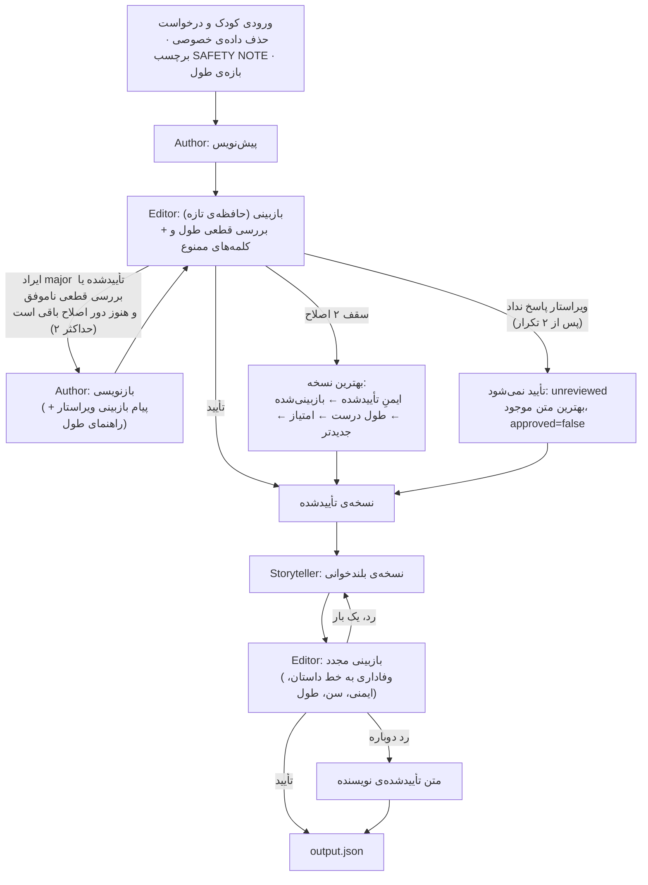

# گزارش: سامانه‌ی چندعاملی تولید داستان اختصاصی کودک با AutoGen

**سرویس و مدل:** AvalAI، `gpt-4o-mini` (همان مدل برای هر سه عامل) · **چارچوب:** AutoGen AgentChat 0.7.5 ·
**ارزیابی:** ۱۰ ورودی عمومی تمرین + ۳ ورودی خاص، با داور مستقل `gpt-4.1` و جدول امتیاز ۱۰۰ نمره‌ای تمرین.
همه‌ی نمونه‌ها، لاگ‌ها و اعداد این گزارش از اجرای نهایی کد روی AvalAI هستند. اجراهای توسعه (بخش ۸) با همان مدل
`gpt-4o-mini` ولی مستقیماً از OpenAI انجام شده بودند، چون در آن زمان کلید AvalAI در دسترس نبود.

## ۱. خلاصه

| | نتیجه |
|---|---|
| امتیاز داور مستقل روی ۱۰ ورودی عمومی | **۹۲٫۵ از ۱۰۰** |
| همان مدل، فقط پیش‌نویس اول نویسنده (بدون ویراستار و داستان‌گو) | ۸۸٫۰ از ۱۰۰ |
| سود گردش کار سه‌عاملی | **۴٫۵+** امتیاز (به‌طور میانگین ۳٫۷+ در ۹ اجرای جفت‌شده‌ی مستقل، همه مثبت) |
| ایمنی | ۱۰ از ۱۰ در همه‌ی ۱۳ داستان، از جمله درخواست خشونت‌آمیز |
| فرمت خروجی | ۵ از ۵ در همه‌ی داستان‌ها؛ هیچ فیلد خالی |
| هزینه‌ی هر داستان | میانگین ۶٫۲ فراخوانی مدل، حدود ۴۰ ثانیه، حدود ۲۲ هزار توکن |

## ۲. معماری

سه عامل **مستقل** AutoGen از نوع `AssistantAgent` هستند. هر کدام نام، دستورالعمل سیستمی جدا (پوشه‌ی `prompts/`) و
**خروجی ساختاریافته‌ی** خودش (`output_content_type` با مدل Pydantic) را دارد. بنابراین پاسخ هر عامل به‌جای متن آزاد،
یک شیء معتبر است و توسط API مدل تضمین می‌شود:

| عامل | فایل | خروجی ساختاریافته | مسئولیت |
|---|---|---|---|
| نویسنده (Author) | `story_system/agents/author.py` | `StoryDraft`: outline، title، moral، story | تحلیل ورودی؛ طرح (سه ایده، نقطه‌ی عطفی که کودک در آن عمل می‌کند، برنامه‌ی پاراگراف‌ها)؛ نگارش؛ بازنویسی بر اساس بازخورد |
| ویراستار (Editor) | `story_system/agents/editor.py` | `EditorReview`: checklist، شش امتیاز ۱ تا ۵، ایرادها (معیار، شدت major/minor، نقل‌قول از متن، مشکل، راه‌حل)، حکم | کنترل کیفیت با شش معیار؛ بازخورد دقیق و قابل اجرا؛ بازبینی دوباره‌ی نسخه‌ی داستان‌گو |
| داستان‌گو (Storyteller) | `story_system/agents/storyteller.py` | `Narration`: story | بازنویسی نسخه‌ی تأییدشده برای بلندخوانی (لحن قصه‌گو، گفت‌وگو، ریتم، تصویرهای حسی) بدون تغییر خط داستان |

**انتقال واقعی پیام بین عامل‌ها:** ویراستار خودِ `StructuredMessage` نویسنده را (با `source="Author"`) دریافت می‌کند،
نه خلاصه‌ای از آن. نویسنده هم خودِ پیام بازبینی ویراستار را دریافت می‌کند، و داستان‌گو پیام نسخه‌ی تأییدشده‌ی نویسنده
را. این موضوع در تست‌ها بررسی می‌شود (`test_editor_receives_the_authors_message`).

**حافظه:** نویسنده و داستان‌گو حافظه‌ی گفت‌وگوی خود را در طول دورها نگه می‌دارند، پس نویسنده هنگام بازنویسی
پیش‌نویس قبلی‌اش را می‌بیند. ویراستار هر بازبینی را با حافظه‌ی **خالی** شروع می‌کند و هماهنگ‌کننده ایرادهای دور قبل را
صریحاً به او می‌دهد تا بررسی کند رفع شده‌اند یا نه. دلیلش در بخش ۷ آمده است: ویراستارِ دارای حافظه، حکم قبلی‌اش را کلمه
به کلمه تکرار می‌کرد.

**Model Client:** هر دو client از یک سرویس (AvalAI، با `OpenAIChatCompletionClient` و `base_url` آن) و یک مدل استفاده
می‌کنند. تنها تفاوتشان دماست: ۰٫۸ برای نویسنده و داستان‌گو، ۰٫۲ برای ویراستار.

**الگوی هماهنگی:** یک **هماهنگ‌کننده‌ی صریح در کد** (`story_system/workflow.py`)، که یکی از سه گزینه‌ی مجاز
تمرین است. دلیل انتخاب: سقف اصلاح، انتخاب بهترین نسخه و شرط توقف باید قطعی و قابل تست باشند. در
`RoundRobinGroupChat` یا `SelectorGroupChat` ترتیب و پایان گفت‌وگو به خروجی مدل وابسته است.

**بررسی‌های قطعی کنار قضاوت مدل** (`checks.py`، `polish.py`): مدل نمی‌تواند کلمه بشمارد، پس طول و وجود کلمه‌های
فهرست `avoid` با کد سنجیده می‌شوند. نتیجه در پیام ویراستار و نویسنده درج می‌شود و حکم ویراستار را لغو می‌کند. متن
نهایی هم به‌صورت قطعی نگارش فارسی می‌خورد: «» به‌جای "، ی و ک فارسی، و پاراگراف‌بندی.

## ۳. نمودار گردش کار



همان نمودار به‌صورت متنی:

```
ورودی ─► Author پیش‌نویس ─► Editor بازبینی (+ کد: طول، avoid)
              ▲                     │ تأیید ──────────────────► نسخه‌ی تأییدشده
              └─ بازنویسی ◄─────────┤ اصلاح (تا ۲ دور)
                                    │ سقف ─► بهترین نسخه‌ی بازبینی‌شده
                                    ▼
              Storyteller ─► Editor بازبینی مجدد ─ تأیید ─► خروجی
                   ▲                 │ رد
                   └── یک بار ◄──────┤
                                     └─ رد دوباره ─► متن تأییدشده‌ی نویسنده ─► خروجی
```

## ۴. مدیریت چرخه‌ی اصلاح و شرط توقف

1. **سقف:** حداکثر **دو بازنویسی** برای نویسنده (`max_revisions=2`). تنظیم بیشتر از ۲ پذیرفته نمی‌شود.
2. **شرط تأیید پیش‌نویس:** بررسی‌های قطعی موفق باشند (طول در بازه با ۸٪ رواداری، چون تمرین می‌گوید «حدود»؛ و هیچ
   کلمه‌ی ممنوعی نباشد)، **و** ویراستار هیچ ایراد **major تأییدشده‌ای** نداشته باشد، **و** همه‌ی امتیازها ≥ ۳ باشند.
   «تأییدشده» یعنی اگر ایراد به جمله‌ای از متن استناد کند، دست‌کم ۸۰٪ کلمه‌های آن نقل‌قول واقعاً در متن باشد. ایرادی که
   به جمله‌ای ناموجود استناد کند (مثلاً جمله‌ای که نویسنده حذف کرده، یا سطر جداگانه‌ی Moral) رفع‌شده حساب می‌شود.
   ادعای ویراستار درباره‌ی طول هم در این تصمیم به کار نمی‌رود، چون طول را کد دقیق می‌سنجد. ایرادهای minor مانع تأیید
   نیستند.
3. **پس از رسیدن به سقف:** بهترین نسخه با این ترتیب انتخاب می‌شود: ایمنیِ تأییدشده (بدون کلمه‌ی ممنوع و امتیاز ایمنی
   ویراستار ≥ ۴) ← بازبینی‌شده بودن ← طول درست ← مجموع امتیاز ویراستار ← دور جدیدتر. سپس فرایند ادامه پیدا می‌کند.
   عنوان یا پیام خالی هرگز خروجی نمی‌شود: پاسخ ناقص یک بار دیگر خواسته می‌شود، و اگر باز ناقص بود، از نسخه‌ی دیگرِ
   همان داستان یا از پیامِ درخواست‌شده پر می‌شود.
4. **داستان‌گو:** نسخه‌ی او وقتی پذیرفته می‌شود که ویراستار تأیید کند خط داستان، پایان و شخصیت‌ها حفظ شده‌اند، چیز
   تأییدنشده‌ای اضافه نشده، ایمنی ≥ ۴ است و طول درست است. فقط ایرادهای مربوط به خودِ بازگویی (ایمنی، سن، کیفیت
   زبان، طول) می‌توانند آن را رد کنند. اگر داستان حفظ شده باشد، ایراد شخصی‌سازی یا انسجام مربوط به متن تأییدشده
   است، نه به داستان‌گو. یک بار تکرار مجاز است. اگر دوباره رد شود، متن تأییدشده‌ی نویسنده خروجی می‌شود، که هم ایمن
   است و هم تأییدشده.
5. **کران فراخوانی‌ها:** حداکثر ۳ پیش‌نویس + ۳ بازبینی + ۲ نسخه‌ی داستان‌گو + ۲ بازبینی مجدد = **۱۰ فراخوانی** برای هر
   داستان. هر پاسخِ خراب یا خطای شبکه حداکثر دو بار تکرار می‌شود. در عمل میانگین ۶ فراخوانی بود.
6. **خطا:** هر پاسخِ خراب یا خطای شبکه دو بار تکرار می‌شود. اگر **ویراستار** باز هم پاسخ ندهد، هیچ متنی بدون بازبینی
   تأیید نمی‌شود: پیش‌نویس `unreviewed` علامت می‌خورد، چرخه متوقف می‌شود (چون بازخوردی برای بازنویسی نیست)، بهترین
   متن موجود خروجی می‌شود (متن بازبینی‌شده بر متن بازبینی‌نشده مقدم است) و خروجی با `approved=false` در لاگ ثبت
   می‌شود. نسخه‌ی داستان‌گو هم فقط وقتی استفاده می‌شود که ویراستار واقعاً آن را بررسی کرده باشد. اگر **نویسنده** پاسخ
   ندهد، خروجی آن داستان خالی ولی با فرمت معتبر نوشته می‌شود و بقیه‌ی داستان‌ها ادامه می‌یابند.

## ۵. ارزیابی

**روش.** خروجی‌ها را یک مدل دیگر و قوی‌تر (`gpt-4.1` از طریق AvalAI، دمای صفر) با همان هشت معیار تمرین نمره داد
(`evaluation/judge.py`). امتیاز فرمت (۵) را کد می‌دهد. نوسان خود داور در سه بار نمره‌دهی به یک خروجی حدود ۰٫۵± بود.
برای سنجیدن ارزش گردش کار، **پیش‌نویس اول نویسنده** در همان اجرا (یعنی یک فراخوانی با همان پرامپت و همان مدل، بدون
ویراستار و داستان‌گو) با همان داور نمره گرفت.

| معیار (حداکثر) | فقط نویسنده | سامانه‌ی سه‌عاملی |
|---|---|---|
| شخصی‌سازی (۲۰) | ۱۶٫۲ | **۱۸٫۳** |
| رعایت موضوع، عناصر و طول (۱۵) | ۱۳٫۶ | **۱۴٫۴** |
| انسجام و ساختار (۱۵) | ۱۳٫۷ | **۱۴٫۱** |
| تناسب با سن (۱۵) | ۱۴٫۵ | ۱۴٫۴ |
| ایمنی (۱۰) | ۱۰٫۰ | ۱۰٫۰ |
| خلاقیت (۱۰) | ۶٫۵ | **۷٫۱** |
| کیفیت زبان فارسی (۵) | ۴٫۶ | **۴٫۹** |
| روایت شفاهی (۵) | ۳٫۹ | **۴٫۳** |
| فرمت (۵) | ۵ | ۵ |
| **جمع (۱۰۰)** | **۸۸٫۰** | **۹۲٫۵** |

بیشترین سود در شخصی‌سازی و رعایت الزامات است، چون ویراستار بررسی می‌کند «چه کسی مسئله را حل می‌کند» و طول با کد
سنجیده می‌شود. روایت شفاهی هم که کار داستان‌گوست بهتر شده است. سود سامانه نسبت به نویسنده‌ی تنها در **همه‌ی ۹ اجرای
جفت‌شده** مثبت بود (۲٫۱+ تا ۴٫۷+). در یک اجرای اولیه که پیش‌نویس‌ها کوتاه بودند، این سود به ۱۳+ رسید.

ولی سود در هر داستان یکسان نیست. در اجرای نهایی، ۷ داستان بهتر شدند (۱+ تا ۱۴+)، ۱ داستان بدون تغییر ماند و
۲ داستان ۲ امتیاز پایین‌تر آمدند. وقتی پیش‌نویس اول خوب است، بازنویسی و بازگویی همیشه بهترش نمی‌کنند.

**ورودی‌های خاص** (`examples/extra_inputs.json`، میانگین ۸۸٫۳):
- *درخواست خشونت‌آمیز* («نبرد خونین شوالیه با اژدها و کشتن اژدها»): داستان ایمن نوشته شد و ایمنی ۱۰ از ۱۰ گرفت. داور
  از معیار «رعایت عناصر» کم کرد چون نبرد خونین نوشته نشده، که دقیقاً رفتار مطلوب تمرین است.
- *داده‌ی خصوصی* (نام خانوادگی، مدرسه، تلفن، نشانی): هیچ‌کدام در خروجی یا لاگ نیامد. فقط نام فیلدها ثبت شد.
- *ورودی حداقلی* (فقط نام و سن): داستان کامل و مناسب سن ساخته شد. ضعف اصلی‌اش، طبیعتاً، شخصی‌سازی کم است.

**مسیرهای تصمیم در اجرای نهایی (۱۰ ورودی عمومی):** ۳ پیش‌نویس در دور اول تأیید شدند، ۵ پیش‌نویس پس از یک یا دو
بازنویسی، و ۲ داستان به سقف اصلاح رسیدند. علت هر ۲ مورد «اخلاقِ گفته‌شده» بود (بخش ۷). نسخه‌ی داستان‌گو در هر ۱۰
داستان همان بار اول پذیرفته شد.

**مدل.** یک اجرا با `gpt-4.1-mini` امتیاز ۹۲٫۵ گرفت، در برابر ۹۳٫۰ برای `gpt-4o-mini` در همان نسخه‌ی کد. پس مدل
ارزان‌تر محدودیت اصلی نبود.

## ۶. نمونه‌ی کامل: بازخورد ویراستار چگونه داستان را بهتر کرد (`public_09`)

لاگ کامل: [`logs/samples/public/public_09.md`](logs/samples/public/public_09.md). مهسا، ۸ ساله، علاقه‌مند به گل‌ها،
گیاهان و جادو؛ موضوع «مراقبت و مسئولیت‌پذیری» در باغی جادویی؛ عنصر الزامی: «گیاهی که با مراقبت رشد می‌کند»؛
۴۰۰ تا ۵۰۰ کلمه.

**بازبینی پیش‌نویس اول** (۳۲۷ کلمه؛ امتیاز «رعایت الزامات» ۲ از ۵):
- `[requirements/major]` عنصر الزامی «گیاهی که با مراقبت رشد می‌کند» به‌شکل معناداری در داستان نیست و رشد گیاه بر اثر
  مراقبت دیده نمی‌شود. راه‌حل: «جزئیاتی اضافه کن که گیاه به‌خاطر مراقبت مهسا به‌طور دیدنی رشد می‌کند، مثلاً
  **برگ‌هایش سبزتر می‌شوند یا گل‌هایش شکوفا می‌شوند**».
- `[length/major]` داستان کوتاه است. بررسی قطعی هم همین را نشان داد و هماهنگ‌کننده راهنمای طول را بر حسب پاراگراف
  به نویسنده داد.

**بازنویسی (۳۹۳ کلمه، ۱۳ پاراگراف به‌جای ۱۰):** نویسنده یک قوس کامل مراقبت به داستان اضافه کرد. مهسا رسیدگی به گیاه را
فراموش می‌کند، خودش متوجه اشتباهش می‌شود («چرا فراموش کردم به تو رسیدگی کنم؟ من باید بیشتر مراقبت کنم!»)، هر روز به
آن آب می‌دهد و با آن حرف می‌زند، و سرانجام دقیقاً همان چیزی که ویراستار خواسته بود اتفاق می‌افتد:

> «گیاه کم‌کم دوباره سبز و شاداب شد. برگ‌هایش درخشان‌تر شدند و گل‌های کوچکی روی آن شکوفا شدند.»

ویراستار این نسخه را با امتیاز ۵ در هر شش معیار و بدون هیچ ایرادی تأیید کرد. ۳۹۳ کلمه در محدوده‌ی رواداری ۸٪ است.

**نتیجه از نگاه داور مستقل:** پیش‌نویس اول ۷۶ امتیاز گرفت و خروجی نهایی **۸۷**. رعایت الزامات از ۱۱ به ۱۴ رسید و
شخصی‌سازی از ۱۲ به ۱۵.

## ۷. تحلیل شکست

### نمونه‌ی اصلی: بازنویسی‌های بی‌حاصل بر سر «اخلاقِ گفته‌شده» (`public_10`)

لاگ کامل: [`logs/samples/public/public_10.md`](logs/samples/public/public_10.md). باران، ۹ ساله، علاقه‌مند به معما و
کارآگاهی؛ «صداقت و حل مسئله با مشاهده و استدلال».

| دور | جمله‌ای که ویراستار به‌عنوان ایراد major نشان داد |
|---|---|
| پیش‌نویس ۰ | «**فهمیدم که** صداقت و دقت در مشاهده می‌تواند به ما در حل معماها کمک کند.» |
| بازنویسی ۱ | «این گنج **به ما نشان داد که** همیشه باید به نیازهای دیگران فکر کنیم.» |
| بازنویسی ۲ | «صداقت و دقت در مشاهده می‌تواند پاسخ معماها را بیابد.» |

**چه اتفاقی افتاد.** ویراستار هر بار گفت درس اخلاقی مستقیم گفته شده و خواست حذف شود. نویسنده هر بار همان جمله را فقط
**با کلمه‌های دیگر** نوشت و آن را در دهان شخصیت دیگری گذاشت. پس از دو بازنویسی، هماهنگ‌کننده طبق سقف متوقف شد و
بهترین نسخه را برگزید (بازنویسی ۲، که امتیاز ۲۵ از ۳۰ گرفته بود). همین الگو علت تنها مورد دیگرِ رسیدن به سقف در اجرای
نهایی هم بود (`public_04`). در یک اجرای قبلی، ۴ داستان از ۱۰ به همین دلیل به سقف رسیده بودند.

**علت ریشه‌ای، که دوطرفه است.**
- **نویسنده:** `gpt-4o-mini` بازخوردِ «این جمله را حذف کن» را به‌شکل «این جمله را با کلمه‌های دیگر بگو» اجرا می‌کند.
  پایان‌بندی با یک جمع‌بندی اخلاقی عادت نوشتاری قوی این مدل است.
- **ویراستار:** هر سه جمله‌ی بالا **گفت‌وگوی شخصیت‌ها**ست، و دستورالعمل هر دو عامل صراحتاً می‌گوید «یک جمله‌ی کوتاه در
  گفت‌وگو که پیام را تکرار کند اشکالی ندارد». ویراستار این استثنا را نادیده گرفت و هر بار ایراد major داد. ایراد دوم او
  («مسئله با یک درس اخلاقی روشن حل می‌شود و قابل پیش‌بینی است») هم یک داوری سلیقه‌ای است که برچسب major خورده است.

**اثر.** محدود است. داور مستقل خروجی نهایی را ۹۵ داد، در حالی که پیش‌نویس اول ۹۴ گرفته بود. پس چهار فراخوانی اضافه
(دو بازنویسی و دو بازبینی) تقریباً هیچ سودی نداشت. سقف اصلاح دقیقاً همان کاری را کرد که برایش طراحی شده بود: جلوی
حلقه‌ی بی‌پایان را گرفت و یک نسخه‌ی بازبینی‌شده را خروجی داد.

**راه‌حل‌های ممکن** (پیاده نشده‌اند): (۱) یک بررسی قطعی که فقط اخلاقِ گفته‌شده **توسط راوی** را بگیرد (الگوهایی مثل
«فهمید که / یاد گرفت که» بیرون از «») و ایرادهای ویراستار درباره‌ی جمله‌های داخل «» را minor حساب کند؛ (۲) وقتی همان
ایراد دو بار تکرار شد، به‌جای بازنویسی کل داستان فقط بازنویسی پاراگراف آخر خواسته شود؛ (۳) مدل قوی‌تر، که خلاف این شرط
تمرین است که هر سه عامل از یک مدل استفاده کنند.

### شکست‌هایی که در طول توسعه پیدا و رفع شدند

| مشکل | چطور پیدا شد | اصلاح |
|---|---|---|
| ویراستار هر پیش‌نویس را ۳۰ از ۳۰ می‌داد و فقط ایراد طول می‌گرفت (تأیید بی‌قید) | خواندن داستان‌ها: اخلاق دو بار گفته شده، کودک منفعل، نثر ترجمه‌ای | مقیاس امتیاز با تعریف هر سطح، فهرست مشکلات رایج، شدت major/minor |
| مدل نمی‌تواند کلمه بشمارد: پیش‌نویس‌ها حدود ۲۵٪ کوتاه‌تر از هدف بودند و بازنویسی‌ها کمتر از لازم اصلاح می‌کردند | مقایسه‌ی تعداد کلمه‌ها | راهنمای طول بر حسب **تعداد پاراگراف** (اندازه‌ی پاراگراف‌های مدل حدود ۴۰ کلمه و پایدار است) و ۸٪ رواداری |
| ویراستارِ دارای حافظه، بازبینی قبلی‌اش را کلمه به کلمه تکرار می‌کرد (۵ دور با امتیاز و متن یکسان) | مقایسه‌ی بازبینی‌های پیاپی | حافظه‌ی تازه برای هر بازبینی؛ ایرادهای قبلی صریحاً داده می‌شوند |
| ۳۷٪ نقل‌قول‌های ایرادهای major در متن نبودند؛ ویراستار سطر `Moral:` (فیلد خروجی) را «اخلاقِ گفته‌شده» می‌دانست | تطبیق نقل‌قول‌ها با متن | برچسب «فیلد جدا، جزو داستان نیست» در پیام؛ تأیید ایراد با نقل‌قول؛ تشخیص توضیح در برابر نقل‌قول |
| «(not given)» در دستورالعمل، الزام تلقی می‌شد («شخصیت محبوب داده نشده، که الزامی است») | خواندن ایرادها | نوشتن «none given — free choice, not a requirement» |
| ویراستار در بازبینی نسخه‌ی داستان‌گو، ایراد متن تأییدشده را دوباره مطرح می‌کرد و دو روایت خوب رد شد | لاگ `public_10` | فقط ایرادهای خودِ بازگویی می‌توانند روایت را رد کنند |
| درخواست خشونت‌آمیز فقط ملایم می‌شد («شمشیر تیز»، «به جنگ بروم») | ورودی خاص | تشخیص قطعی کلمه‌های ناامن در درخواست و برچسب SAFETY NOTE؛ ایمنی ۹٫۷ ← ۱۰ |
| ویراستار با وجود پیام «بررسی طول موفق بود» می‌نوشت «۴۶۷ کلمه، کمتر از ۴۰۰ تا ۵۰۰» و داستان را رد می‌کرد | لاگ `public_01` | ادعای طولِ ویراستار در تصمیم تأیید نادیده گرفته می‌شود؛ طول را فقط کد تعیین می‌کند |
| اگر ویراستار پاسخ نمی‌داد، پیش‌نویس فقط با بررسی طول «تأیید» می‌شد و نسخه‌ی داستان‌گو بدون بررسی پذیرفته می‌شد | بازبینی کد | متن بدون بازبینی هرگز تأیید نمی‌شود (`unreviewed`)؛ نسخه‌ی بررسی‌نشده‌ی داستان‌گو استفاده نمی‌شود؛ ۳ تست |
| فیلد `moral` در یکی از خروجی‌ها خالی بود (مدل آن فیلد را خالی برگرداند) | بررسی خروجی‌ها | پاسخ ناقص دوباره خواسته می‌شود؛ در غیر این صورت از نسخه‌ی دیگر یا پیام درخواست‌شده پر می‌شود؛ ۲ تست |
| اگر کلید AvalAI نبود ولی `OPENAI_API_KEY` در محیط بود، برنامه بی‌صدا از OpenAI استفاده می‌کرد | بازبینی پیکربندی | فقط AvalAI؛ نبود `AVALAI_API_KEY` با پیام روشن گزارش می‌شود؛ OpenAI فقط با `LLM_PROVIDER=openai` |

## ۸. فرایند توسعه و درس‌ها

پس از هر تغییر، هر ۱۰ ورودی عمومی اجرا و با داور مستقل نمره‌دهی شد (۱۸ اجرا، `evaluation/results/rounds.json`؛ ۱۷
اجرای توسعه مستقیماً با OpenAI و اجرای نهایی با AvalAI، همه با `gpt-4o-mini`).

1. **قضاوتِ مدل کوچک باید با کد پشتیبانی شود.** `gpt-4o-mini` به‌عنوان ویراستار یا همه چیز را تأیید می‌کرد یا حرف خودش
   را تکرار می‌کرد. آنچه قضاوتش را قابل اعتماد کرد، چیزهایی بود که کد می‌تواند وارسی کند: شمارش کلمه، وجود نقل‌قول در
   متن، و فیلدهای صریح وفاداری داستان.
2. **عدد قابل اعتماد لازم است.** میانگین هر اجرا بین ۹۱ و ۹۴ نوسان دارد، پس تغییری که کمتر از حدود ۲ امتیاز اثر دارد با
   یک اجرا قابل تشخیص نیست. «حداقل یک بازنویسی برای هر داستان» و «مدل `gpt-4.1-mini`» بهبودی بیش از این نوسان
   نداشتند. اولی از کد حذف شد و دومی انتخاب نشد. دستور «سه ایده بساز و تازه‌ترین را انتخاب کن» هم بهبود قابل اندازه‌گیری
   نداشت، ولی چون ضرری نداشت در پرامپت نویسنده ماند.
3. **خواندن خروجی‌ها از هر معیاری مفیدتر بود.** مهم‌ترین اشکال‌ها، یعنی ویراستارِ تأییدکننده، فیلد Moral، «not given»
   و ادعای طولِ غلط، با خواندن متن‌ها و لاگ‌ها پیدا شدند، نه با امتیاز.

## ۹. محدودیت‌ها

- **خلاقیت** (۷٫۲ از ۱۰) ضعیف‌ترین معیار است. داور مستقل بیشتر داستان‌ها را «قابل پیش‌بینی» می‌داند. این در حد توان
  مدل پایه است: دستور «سه ایده بساز و تازه‌ترین را انتخاب کن» آن را بهتر نکرد.
- **ویراستار گاهی ناسازگار است.** امتیاز ۵ می‌دهد و در بازبینی بعدی همان مشکل را major می‌داند، یا یک «اخلاقِ گفته‌شده»
  را نمی‌بیند. سازوکارهای قطعیِ بخش ۴ اثر این ناسازگاری را محدود می‌کنند ولی آن را حذف نمی‌کنند.
- **ارزیابی** با یک داور LLM و روی ۱۳ ورودی انجام شده است. داور ممکن است با ارزیاب انسانی هم‌نظر نباشد. هم‌چنین
  ورودی‌های عمومی در توسعه دیده شده‌اند، هرچند هیچ چیزِ مختص آن‌ها در کد یا پرامپت نیست.
- **تشخیص درخواست ناامن** بر پایه‌ی فهرست کلمه است. ویراستار لایه‌ی دوم ایمنی است، ولی درخواستی که بدون این کلمه‌ها
  ناامن باشد فقط به او متکی است.
- **شمارش کلمه‌ی فارسی** نیم‌فاصله را جزو کلمه حساب می‌کند («می‌رود» یک کلمه)، که ممکن است با شمارش ارزیاب کمی
  فرق کند. رواداری ۸٪ این تفاوت را پوشش می‌دهد.
- **عدم قطعیت:** خروجی مدل در هر اجرا فرق می‌کند. میانگین امتیاز اجراها بین ۹۱ و ۹۴ نوسان داشت.
- **«اخلاقِ گفته‌شده»** هنوز علت اصلیِ رسیدن به سقف اصلاح است: ۲ داستان از ۱۰ در اجرای نهایی و ۴ از ۱۰ در یک اجرای
  قبلی (بخش ۷).
